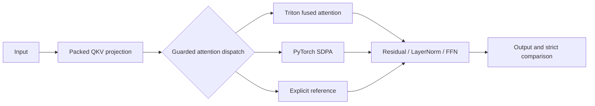

# Triton Transformer Kernels

**Custom GPU kernels, strict numerical validation, and reproducible performance engineering.**

We built fused attention and residual/LayerNorm kernels in Triton, integrated them
into a PyTorch Transformer, and measured the complete model against an unchanged
explicit-attention baseline. The project began as TikTok TechJam 2026 Track 3;
this repository presents the implementation, experiments, and evidence.

[Technical case study](docs/PORTFOLIO.md) · [Kernel design](docs/KERNEL_DESIGN.md) ·
[Reproduce](docs/guides/REPRODUCING.md) · [Raw evidence](docs/results/README.md)

## Results

On an **NVIDIA RTX 5070 Ti**, the current implementation passes
**13/13 executable final-shape cases**, with **zero failed elements across
938,885,120 comparisons** per five-seed matrix. The source-authorized
100,000-token resource case is skipped and excluded from the pass count.


The [primary run](docs/results/rtx-5070-ti-2026-10-18-c16-final.json) and
[complete confirmation](docs/results/rtx-5070-ti-2026-10-18-c16-final-confirmation.json)
measured **4.170–4.190× geometric-mean end-to-end speedup** under float32/no-padding
assumptions. Bars show the lower result; whiskers show the range across runs.
The wide-model row spans **1.051–1.054×** and the huge-batch row **1.775–1.776×**.
**The 10× aggregate tuning target was not reached.**

**The latest accepted optimization:** collect replay guards and state in one
traversal, preserving all identity/storage/version/device/dtype, module,
normalization and attention-configuration checks. The
[controlled A/B](docs/results/rtx-5070-ti-2026-10-18-c16-replay-validation-ab.json) measured
**1.638–1.659× additional whole-model speedup on the two smallest cases**. Other
shapes are near parity or gain less. All eight replay shapes retain bitwise
control equality and identical signatures. Checks still run on every forward;
input copies, fresh output clones and stream ordering remain unchanged.

The [research and experiment record](docs/experiments/CAMPAIGN-016.md) preserves
the diagnostic upper bound and rejected whole-FFN fusion. That fusion passed
initial seeds and gained about 10% on row 7, but stronger weight/scale tests
found new failed elements. Broader stress also found failures in the unchanged
control, so final-table passes do not establish universal numerical correctness.

These are steady-state GPU inference timings against explicit PyTorch attention,
excluding construction, compilation, cache population, and graph capture.
Input copies, output clones, signature checks, and all GPU work remain timed.
Cross-process aggregate movement includes baseline/workstation variability;
the same-process A/B isolates this validation change. This is not a universal
advantage over PyTorch SDPA.

Current implementation fingerprint (schema 2):
`5bcf25d733d92d571d4531194e9b92fd0a8d3d16a74c72659b5413ca03836dc5`.
Campaign 16 measurements were captured from the dirty working tree based on
`385b7e7`. Repository packaging preserves this source fingerprint and the raw
evidence bytes; the recorded Git revision describes the measurement session.

Historical Campaign 15 measured **3.798–3.912×** at
`eb4217f4a589e66d150cfe3ce36d1eacc4eded4d308984bf5b62e1ed7ed764f4`;
its [component record](docs/experiments/CAMPAIGN-015.md) and raw JSON remain immutable.
Historical Campaign 14 measured **4.600–4.977×** at
`ec46e346b8ab259de4da6d5db7bb90c7235984b6ef52bfecf5f5a89357a94992`;
its [rounding record](docs/experiments/ROUNDED_ATTENTION_OPTIMIZATION.md) and
raw JSON remain immutable.
Historical Campaign 13 measured **3.744–4.187×** at
`de8b6dd8831cb8637ac49cf8f2acfdcf69219e2cb9c303f60af81d123f34e868`; its
[launch-overhead record](docs/experiments/LAUNCH_OVERHEAD_OPTIMIZATION.md) and raw JSON
remain immutable. Historical Campaign 12 measured **2.422–2.776×** at
`abb639ce7fa68c9af9f21d776ca3d3afaa9e8f22be7e0ae8116ec4f71068c5ad`;
its [record](docs/experiments/PUBLICATION_OPTIMIZATION.md) preserves the
causal-tile-pruning experiment, including the **0.563×** large-batch regression.
Historical Campaign 11 measured **1.977× / 1.986×** at
`908a0d708cd8f70f44d5f14fda93d3cafb1cc18345f43914e715594cfa7b7ef9`;
its [final artifact](docs/results/rtx-5070-ti-2026-08-29-c11-integrated-final.json)
remains immutable and is not presented as current-source evidence.

## What the code demonstrates

- **GPU programming:** tiled QK → online softmax → P@V in one Triton launch,
  without materializing `[B,H,S,S]` scores or probabilities.
- **Memory and launch optimization:** projection-friendly `[B,S,H,D]` views,
  a derived packed-QKV cache, guarded residual-add/LayerNorm fusion, and bounded
  CUDA replay with parameter invalidation and cross-stream ordering.
- **Numerical engineering:** fp32 accumulation, preserved dtype boundaries,
  causal/padding masks, and accuracy-safe routing when errors compound in depth.
- **Software engineering:** strict state-dict compatibility, cache invalidation,
  explicit backend counters, fail-closed runners, boundary/negative tests, and CI.
- **Experimental discipline:** frozen reference checksums, CUDA-event samples,
  alternating run order, profiler proof, and source-fingerprinted JSON results.

These skills are relevant to numerical and performance-sensitive software,
including quant-development-adjacent work.

## How it works



The general kernel streams K/V tiles and maintains fp32 running softmax statistics
and output accumulators. The bounded rounded kernel normalizes a full key tile
before rounding probabilities for P@V. Attention arithmetic remains quadratic in sequence length;
attention-specific global intermediate storage becomes linear. Causal traversal
now skips entirely future tiles while retaining the mask inside the diagonal tile.
The model keeps the baseline parameter structure and loads weights strictly.

Automatic dispatch is tuned to measured workloads. Sensitive low-precision and
unsupported-head cases retain reference math; some shapes use SDPA, and two
final rows retain exact-layer/Triton hybrids outside the rounded SM120 policy. The residual/LayerNorm fusion applies
to four exact configurations. [Kernel design](docs/KERNEL_DESIGN.md) documents
all guards, numerical choices, and memory trade-offs.

## Reproduce

Measured environment: Windows 11 · Python 3.12.10 · PyTorch 2.13.0+cu130 ·
CUDA 13.0 · Triton 3.7.1 (`triton-windows`) · NVIDIA driver 616.56.

```powershell
py -3.12 -m venv .venv
$python = ".venv\Scripts\python.exe"
& $python -m pip install torch==2.13.0 --index-url https://download.pytorch.org/whl/cu130
& $python -m pip install -r requirements.txt
& $python -m pytest tests -q
& $python benchmarks/run_organizer_validation.py `
  --matrix benchmarks/final_evaluator_shapes.json --out results/final.json
```

For CPU-only setup, held-out/source-derived matrices, profiling, WSL, and Colab,
use the [reproduction guide](docs/guides/REPRODUCING.md).
[CPU CI](.github/workflows/ci.yml) checks contracts and artifacts; GPU tests skip
without CUDA/Triton and do not become GPU evidence.

The strict repository comparator requires every element to satisfy
`abs_error <= 0.001 OR abs_error <= 0.01 * abs(reference)`.
Correctness precedes timing. Numerical failures, exceptions, OOM, and zero executed
cases cannot be reported as success. Organizer sources are checksum-protected.

## Repository layout

| Path | Purpose |
| --- | --- |
| [`transformer_opt/kernels/`](transformer_opt/kernels/) | Owned attention and residual/LayerNorm kernels |
| [`transformer_opt/submission.py`](transformer_opt/submission.py) | Model integration, QKV cache, guarded execution |
| [`transformer_opt/dispatch.py`](transformer_opt/dispatch.py) | Observable Triton / SDPA / reference selection |
| [`benchmarks/`](benchmarks/) | Frozen references, shape manifests, runners, profiling, A/B experiment |
| [`tests/`](tests/) | CPU contracts, GPU correctness, boundary/fallback tests, artifact integrity |
| [`docs/PORTFOLIO.md`](docs/PORTFOLIO.md) | Technical case study and ready-to-use portfolio copy |
| [`docs/results/`](docs/results/) | Versioned raw measurements and evidence index |
| [`docs/experiments/`](docs/experiments/) | Optimization decisions, controls, and historical campaigns |
| [`notebooks/`](notebooks/) | Fingerprint-pinned Colab runner |
| [`deliverables/`](deliverables/) / [`hackathon-docs/`](hackathon-docs/) | Historical competition material |

## Scope and limitations

The implementation is forward/inference-only. Launch policies and performance
claims are measured on the RTX 5070 Ti. Direct custom attention supports the
head widths and sequence limits in [the support policy](transformer_opt/config.py);
that envelope does not establish a speedup on every GPU or input. Packed QKV
trades additional derived-weight memory for fewer GEMMs. Automatic low-precision
execution prioritizes the unusually strict reference tolerance over fused speed.

The published final table omits dtype, padding, timing, and backward policy;
[requirements](docs/REQUIREMENTS.md) state our assumptions. There is no production
latency or deployment claim. Historical campaigns remain available for audit,
with a [documentation map](docs/README.md) for deeper reading.

AI-assisted development is disclosed in the
[technical report](deliverables/03_TECHNICAL_REPORT.md#14-ai-assisted-development-and-human-contribution).
See [contributor guidance](CONTRIBUTING.md) and
[third-party attribution](THIRD_PARTY_NOTICES.md) for reference-source boundaries.
