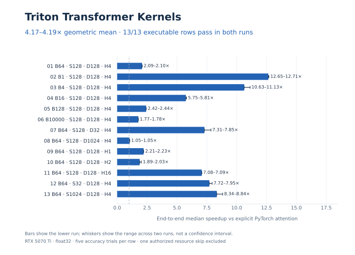
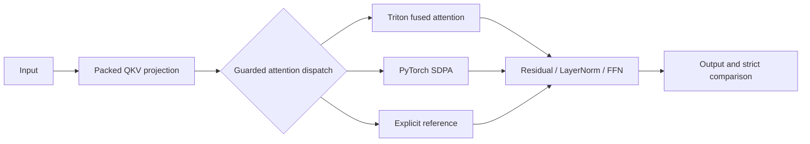

# Triton Transformer Kernels

**Fused GPU kernels for Transformer inference, backed by strict numerical checks and reproducible benchmarks.**

We built attention and residual/LayerNorm kernels in Triton, integrated them into
a PyTorch Transformer, and benchmarked the complete model against an unchanged
explicit-attention baseline. The project began as TikTok TechJam 2026 Track 3.

[Results](#results) · [How it works](#how-it-works) · [Quickstart](#reproduce) ·
[Technical case study](docs/PORTFOLIO.md) · [Documentation](docs/README.md)

## Results

The current implementation achieves **4.170–4.190× geometric-mean end-to-end
speedup** against explicit PyTorch attention on an **NVIDIA RTX 5070 Ti**.
Results use float32 inputs with no padding.



| Measure | Result |
| --- | --- |
| Geometric-mean speedup | **4.170–4.190×** |
| Wide-model speedup | 1.051–1.054× |
| Huge-batch speedup | 1.775–1.776× |
| Executable final-shape cases | **13/13 passed** |
| Failed elements per five-seed matrix | **0 across 938,885,120 comparisons** |

The chart shows the lower speedup from the
[primary run](docs/results/rtx-5070-ti-2026-10-18-c16-final.json) and
[confirmation run](docs/results/rtx-5070-ti-2026-10-18-c16-final-confirmation.json).
Whiskers show the range across both runs. The source-authorized 100,000-token
resource case is skipped and excluded from the pass count.
**The 10× aggregate tuning target was not reached.**

### Measurement scope

These are steady-state GPU inference timings. Construction, compilation, cache
population, and graph capture are excluded. Input copies, output clones,
signature checks, and all GPU work remain timed. Separate benchmark runs include
baseline and workstation variability. These results do not establish a universal
advantage over PyTorch SDPA.

### Latest optimization

Replay validation now collects model state and safety guards in one traversal.
A [controlled A/B comparison](docs/results/rtx-5070-ti-2026-10-18-c16-replay-validation-ab.json)
measured **1.638–1.659× additional whole-model speedup on the two smallest cases**.
Other shapes are near parity or gain less. All eight replay shapes retain
bitwise control equality and identical signatures, with state checks, input
copies, fresh output clones, and stream ordering preserved.

The [latest experiment record](docs/experiments/CAMPAIGN-016.md) explains the
accepted change and rejected whole-FFN fusion. Earlier measurements, source
identities, and rejected attempts are available in the
[optimization history](docs/experiments/OPTIMIZATION_HISTORY.md) and
[raw evidence](docs/results/README.md).

## How it works



The attention kernel streams K/V tiles and maintains fp32 running softmax
statistics and output accumulators. It avoids materializing the full
`[B,H,S,S]` score and probability tensors. Attention arithmetic remains
quadratic in sequence length, while attention-specific global intermediate
storage becomes linear. Causal execution skips entirely future tiles and keeps
elementwise masking inside the diagonal tile.

| Component | Implementation |
| --- | --- |
| Attention | Fused QK, online softmax, and P@V with guarded Triton, SDPA, and reference routes |
| QKV projection | Projection-friendly `[B,S,H,D]` views and a derived packed-weight cache |
| Normalization | Fused residual-add/LayerNorm for four exact configurations |
| CUDA replay | Bounded graph reuse with parameter invalidation and stream ordering |
| Compatibility | Baseline parameter structure, strict state-dict loading, and preserved dtype boundaries |
| Validation | Backend counters, frozen references, boundary tests, and source-linked benchmark artifacts |

Dispatch is tuned to measured workloads. Sensitive low-precision and unsupported
head configurations retain reference math. Some shapes use SDPA, and two final
rows use exact-layer/Triton hybrids outside the rounded SM120 policy.
The [kernel design](docs/KERNEL_DESIGN.md) explains the guards, rounded attention
path, numerical choices, and memory trade-offs.

## Reproduce

The recorded benchmark environment uses Windows 11, Python 3.12.10,
PyTorch 2.13.0+cu130, CUDA 13.0, Triton 3.7.1 (`triton-windows`), and
NVIDIA driver 616.56.

```powershell
py -3.12 -m venv .venv
$python = ".venv\Scripts\python.exe"
& $python -m pip install torch==2.13.0 --index-url https://download.pytorch.org/whl/cu130
& $python -m pip install -r requirements.txt
& $python -m pytest tests -q
& $python benchmarks/run_organizer_validation.py `
  --matrix benchmarks/final_evaluator_shapes.json --out results/final.json
```

The [reproduction guide](docs/guides/REPRODUCING.md) covers CPU-only setup,
held-out and source-derived matrices, profiling, WSL, and Colab.
[CPU CI](.github/workflows/ci.yml) checks contracts and artifacts. GPU tests skip
without CUDA/Triton and do not count as GPU validation.

Every compared element must satisfy:

```text
abs_error <= 0.001 OR abs_error <= 0.01 * abs(reference)
```

Correctness is checked before timing. Numerical failures, exceptions, OOM, and
zero executed cases cannot be reported as success. Organizer sources are
checksum-protected.

## Repository layout

| Path | Purpose |
| --- | --- |
| [`transformer_opt/kernels/`](transformer_opt/kernels/) | Attention and residual/LayerNorm kernels |
| [`transformer_opt/submission.py`](transformer_opt/submission.py) | Model integration, QKV cache, and guarded execution |
| [`transformer_opt/dispatch.py`](transformer_opt/dispatch.py) | Triton, SDPA, and reference selection |
| [`benchmarks/`](benchmarks/) | Frozen references, shape manifests, runners, and profiling |
| [`tests/`](tests/) | CPU contracts, GPU correctness, fallback checks, and artifact integrity |
| [`docs/`](docs/README.md) | Technical case study, design, requirements, and reproduction guides |
| [`docs/results/`](docs/results/) | Raw measurements and evidence index |
| [`docs/experiments/`](docs/experiments/) | Optimization history, controls, and rejected attempts |
| [`notebooks/`](notebooks/) | Source-pinned Colab runner |
| [`deliverables/`](deliverables/) and [`hackathon-docs/`](hackathon-docs/) | Historical competition material |

## Scope and limitations

- **Inference only.** The implementation supports forward execution.
- **Hardware-specific measurements.** Launch policies and performance claims are
  measured on the RTX 5070 Ti. The [support policy](transformer_opt/config.py)
  defines supported head widths and sequence limits.
- **Numerical limits.** Final-table passes do not establish universal correctness.
  Broader weight and scale stress tests found failures in the unchanged control.
  Whole-FFN fusion was rejected after introducing additional failed elements.
- **Memory trade-offs.** Packed QKV uses additional derived-weight memory to
  reduce GEMM launches. Low-precision routing prioritizes the reference tolerance.
- **Evaluation assumptions.** The organizer's final table omits dtype, padding,
  timing, and backward policy. The [requirements](docs/REQUIREMENTS.md) document
  the assumptions. These measurements make no production latency or deployment claim.

For contribution guidance and attribution, see
[Contributing](CONTRIBUTING.md) and [Third-party notices](THIRD_PARTY_NOTICES.md).
AI-assisted development is disclosed in the
[technical report](deliverables/03_TECHNICAL_REPORT.md#14-ai-assisted-development-and-human-contribution).
