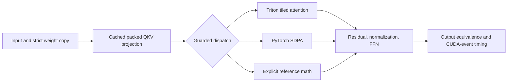

# Triton Transformer Kernels — technical case study

We optimized a pre-LayerNorm Transformer under a strict output-equivalence
contract. The work spans custom GPU kernels, model integration, numerical
debugging, profiling, controlled experiments, and reproducible benchmark tooling.
It began as a TikTok TechJam 2026 Track 3 project; this case study focuses on the
engineering rather than submission logistics.

## The problem

The supplied PyTorch baseline explicitly computes attention scores and
probabilities of shape `[B,H,S,S]`. Those intermediates grow quadratically with
sequence length and require separate masking, softmax, and matrix-multiply
operations. Small configurations also spend a meaningful share of time launching
operations rather than doing useful arithmetic.

The challenge was to remove that work while preserving parameter names, exact
GELU, causal/padding semantics, and a demanding elementwise correctness gate
across a multi-layer model. A faster isolated kernel would not be enough if its
rounding errors compounded or the model became slower.

## What we built



The model keeps the reference state-dict surface. Its derived packed-QKV cache
invalidates when parameter versions, storage, device, or dtype change. It remains
outside persistent model state. Unsupported cases have explicit fallback routes;
forced Triton execution fails clearly rather than silently claiming a custom run.

| Surface | Engineering contribution | Read the implementation |
| --- | --- | --- |
| Attention | Tiled QK, online softmax, and P@V in one Triton launch | [`attention.py`](../transformer_opt/kernels/attention.py) |
| Memory layout | Consume projection-friendly `[B,S,H,D]` views; avoid quadratic score storage | [`submission.py`](../transformer_opt/submission.py) |
| Launch overhead | Packed QKV, residual-add/LayerNorm fusion, and bounded CUDA replay | [`submission.py`](../transformer_opt/submission.py) |
| Numerical control | fp32 accumulators, dtype boundaries, guarded IEEE/TF32x3 and explicitly rounded TF32 dots, accuracy-safe fallbacks | [Kernel design](KERNEL_DESIGN.md) |
| Observable execution | Explicit backend counters, support checks, negative tests, profiler assertions | [`dispatch.py`](../transformer_opt/dispatch.py) |
| Experiment integrity | Frozen organizer checksums, isolated cases, raw timings, source fingerprints | [`run_organizer_validation.py`](../benchmarks/run_organizer_validation.py) |

## The algorithm and its limits

For each query tile, the attention kernel maintains a running maximum `m`,
normalization sum `l`, and output accumulator `A`. For the next score tile `s`:

```text
m_new = max(m, rowmax(s))
alpha = exp(m - m_new)
p = exp(s - m_new)
l_new = alpha * l + rowsum(p)
A_new = alpha * A + p @ V
output = A / l
```

The implementation uses base-2 exponentials with the corresponding score scaling,
fp32 softmax state, and guards for fully masked tiles. It writes only the output,
rather than storing all scores or probabilities. Attention arithmetic remains
`O(B*H*S²*D)`; attention-specific global intermediate storage becomes linear in
sequence length. Tile state, weights, activations, and fallback paths still use
memory. This is an implementation of established online-softmax tiling, not a
claim to invent a new attention algorithm.

Campaign 12 bounds causal K/V traversal by the query tile's last
position. Completely future tiles cannot contribute, so they can be skipped.
The diagonal tile still applies its elementwise causal mask. This reduces work
without changing dtype, dot precision, tile geometry, or model routing. See the
[publication optimization record](experiments/PUBLICATION_OPTIMIZATION.md) for
the control/candidate comparison and final decision.

Campaign 13 adds CUDA-graph replay around unchanged model math for eight measured
small shapes. Current inputs and masks are copied into static buffers; replay
returns an independent output and checks parameter/module state before reuse.
Two exact SM120 attention shapes also use separately validated three-product
TF32 dots. See the [launch-overhead record](experiments/LAUNCH_OVERHEAD_OPTIMIZATION.md)
for the controlled gains, retained memory, rejected linear variants, and unmet
10x aggregate target.

Campaign 14 explicitly rounds Q/K and normalized probabilities/V before
tensor-core dots on four measured SM120 shapes (final rows 2, 3, 7, and 12).
Row 7 uses four custom layers under that policy; row 6 retains its prior hybrid.
A broader, faster prototype failed quarter-scale stress and was rejected.
See the [rounding record](experiments/ROUNDED_ATTENTION_OPTIMIZATION.md).

Campaign 15 additionally groups eight width-32 LayerNorm rows per program on
exact final row 7. It preserves the vendor Welford operation order, with
bitwise direct/model checks, hook fallbacks, and fresh controlled timing. See
the [component record](experiments/CAMPAIGN-015.md).

Campaign 16 collects the same live replay state in one traversal, avoiding
repeated named-module/parameter walks. It preserves mutation and hook checks,
input/output ownership and stream ordering. See the
[replay validation record](experiments/CAMPAIGN-016.md).

## Why correctness constrained the design

The repository uses `abs_error <= 0.001 OR abs_error <= 0.01 * abs(reference)`
with zero failing elements. A single tolerance miss fails an entire case.
Near-zero outputs make absolute error especially important; a maximum relative
error alone cannot describe acceptance under this rule.

Small fused-attention differences accumulated across layers. Earlier IEEE and
TF32x3 candidates could be more accurate mathematically yet differ more from
the comparator than explicitly rounded TF32 inputs. The rounded route is bounded
to measured short-sequence SM120 shapes and TF32-enabled fp32 inference.
The additional stress screen found failures in both broader rounded and prior
routes, especially with quarter-scale inputs. The selected rounded route is
limited to the four passing shapes; the older-route limitation remains explicit.
The additional stress screen found failures in both broader rounded and prior
routes, especially with quarter-scale inputs. The selected rounded route is
limited to the four passing shapes; the older-route limitation remains explicit.
Other precision/device settings retain prior IEEE/TF32x3 math and reference-layer
hybrids. Sensitive low-precision stacks keep reference math. This is a measured,
shape-specialized Transformer rather than a universal replacement.

## How we measured it

We preserved the supplied reference files byte-for-byte, copied weights strictly,
and checked accuracy before timing. GPU measurements use warm-up, CUDA events,
and alternating baseline/optimized order. Results retain source identities,
environment, seeds, backend counts, and failure accounting. Profiler checks prove
that the expected kernels actually execute.

The [current results](../README.md#results) distinguish the published final table,
project-owned held-out cases, and same-session optimization controls. Historical
Campaign 11 results remain attached to their original fingerprint. The
[result index](results/README.md) provides the raw JSON rather than just a headline.

All reported GPU evidence is specific to the RTX 5070 Ti environment. The
100,000-token reference stress row has a source-authorized resource skip and
does not count as a pass. The final table omits dtype and padding, so the measured
contract explicitly states float32 and no padding. Timing excludes model
construction, first-use compilation, cache population, and CUDA-graph capture.
Replay input copies, output clones, and state checks remain inside timed forwards.

## What this demonstrates

For software engineering, the strongest evidence is the integration work around
the kernel: compatibility-preserving state management, explicit fallback
contracts, failure accounting, regression tests, and source-bound reproducibility.
The result is reviewable from implementation through raw measurements.

For quantitative-development-adjacent roles, the relevant skills are numerical
computing, floating-point error analysis, memory/compute trade-offs, profiling,
and controlled empirical decisions. The project does not establish trading,
backtesting, market-data, P&L, or production execution-system experience. CUDA
event medians describe GPU inference latency, not network latency or production
tail latency.

## Portfolio copy

**Card title:** Triton Transformer Kernels

**Card description:** We built custom Triton attention and residual/LayerNorm
kernels, integrated them into a correctness-constrained Transformer, and measured
end-to-end GPU performance with source-fingerprinted benchmarks. The project
demonstrates GPU programming, numerical analysis, performance engineering, and
reproducible experimentation.

**Skills:** Python · PyTorch · Triton · CUDA profiling · numerical computing ·
GPU memory optimization · regression testing · benchmark design.

**Measured result:** Two complete float32/no-padding final-matrix runs measured
4.170–4.190× geometric-mean speedup against explicit PyTorch attention, with 13/13
executable cases passing and zero failed elements across 938,885,120 comparisons
each. The wide-model row spans 1.051–1.054× and the huge-batch row 1.775–1.776×. The 10x
aggregate target remains unmet. Campaign 16's controlled A/B measured 1.638–1.659×
additional speedup on the two smallest cases by collecting live validation
state in one traversal. All eight replay shapes preserve bitwise control
outputs and the prior signature fields. Whole-FFN fusion was rejected after
stronger numerical stress; pre-existing control failures remain documented.
These bounded RTX 5070 Ti results do not establish universal performance or
numerical guarantees.

**Short engineering pitch:** We treated optimization as a measured systems
problem: trace the bottleneck, preserve the numerical contract, test boundaries
and fallbacks, then accept a change only when the complete model benefits.

**Interview paths:**

- Walk through the online-softmax recurrence and why it removes quadratic storage.
- Explain why a faster kernel can leave end-to-end latency unchanged.
- Show a rejected optimization and the measurement that changed the decision.
- Trace cache invalidation and strict state-dict compatibility.
- Explain a one-element numerical failure and the accuracy/performance trade-off.

The [technical report](../deliverables/03_TECHNICAL_REPORT.md#14-ai-assisted-development-and-human-contribution)
records AI-assisted development; acceptance rests on executed evidence.
